<picture>
  <source media="(prefers-color-scheme: dark)" srcset="assets/terminal-dark.svg">
  <source media="(prefers-color-scheme: light)" srcset="assets/terminal-light.svg">
  
</picture>

Merged upstream: [orca&nbsp;#21931](https://github.com/stablyai/orca/pull/21931) · [CodexBar&nbsp;#2925](https://github.com/steipete/CodexBar/pull/2925)

Work: [overseer](https://github.com/tomarai85/overseer) · [court-recover](https://github.com/tomarai85/court-recover) · [RemoteMini](https://github.com/tomarai85/remotemini) · [Flote](https://github.com/tomarai85/flote)

<b>Private projects</b> (names only, updated daily)

<!-- PRIVATE-WORK-INDEX:BEGIN (generated by gh-portfolio-index — do not hand-edit inside) -->

## Private work, by name only

Most of what I build is private. GitHub shows a visitor the green squares and nothing else,
so this is the index: what exists, in what language, and when it last moved. No contents, no
commit messages. Generated daily.

| project | language | last touched |
|---|---|---|
| `brain-training` | JavaScript | 2026-10-15 |
| `yoda-health` | - | 2026-10-15 |
| `internship-2027` | HTML | 2026-10-14 |
| `orca-migration` | Shell | 2026-10-07 |
| `codexbar-fleet` | Swift | 2026-10-06 |
| `claudebar` | Swift | 2026-10-06 |
| `foodge` | Swift | 2026-10-06 |
| `banana-promo-video` | TypeScript | 2026-10-05 |
| `capsomnia-private` | Swift | 2026-10-05 |
| `x-auto-post` | HTML | 2026-10-04 |
| `jev-paper-trader` | TypeScript | 2026-10-01 |
| `cloud-workbench` | - | 2026-09-24 |
| `capcut-bridge` | Python | 2026-09-24 |
| `remotemini-private` | Shell | 2026-09-18 |
| `flote-app` | Swift | 2026-09-18 |
| `metaglass-mac` | Python | 2026-09-18 |
| `income-sprint-2026` | Python | 2026-09-18 |
| `lingo` | TypeScript | 2026-09-17 |
| `Xcode-apps` | Swift | 2026-09-17 |
| `bball-fit-ios` | Swift | 2026-09-16 |
| `codexbar-handoff` | - | 2026-09-12 |
| `foot-cam` | JavaScript | 2026-09-12 |
| `closure-auditor` | Shell | 2026-09-07 |
| `macmini-openclaw-claudeode-Notion` | JavaScript | 2026-09-02 |
| `resonance-os` | TypeScript | 2026-09-02 |
| `deskguard` | Swift | 2026-09-02 |
| `court-recover-archive` | Shell | 2026-07-30 |
| `overseer-archive` | Python | 2026-07-30 |
| `loop-gates` | HTML | 2026-07-30 |
| `replan-loop` | Shell | 2026-07-29 |
| `claude-multi-ai-blueprint` | Shell | 2026-06-23 |
| `helix-electron` | TypeScript | 2026-06-17 |
| `synayaka-private-f3` | HTML | 2026-05-20 |
| `synayaka-ai-tasks-dashboard` | HTML | 2026-05-12 |
| `synayaka-private-f5` | JavaScript | 2026-05-11 |
| `synayaka-private-f1` | JavaScript | 2026-05-11 |
| `yoda-copy-ai-delivery` | Python | 2026-04-15 |
| `claude-code-harness-design` | Shell | 2026-04-05 |
| `with-cursor-uni-t` | HTML | 2026-03-29 |
| `ai-dashboard` | TypeScript | 2026-03-28 |
| `contract-site` | HTML | 2026-03-23 |
| `claude-code-skills` | Shell | 2026-03-17 |
| `macmini-openclaw-claudeode-` | HTML | 2026-03-13 |
| `terminal-test-courser` | HTML | 2026-03-08 |
| `project-cursor` | HTML | 2026-02-23 |

_45 private projects · index regenerated 2026-10-15_

<!-- PRIVATE-WORK-INDEX:END -->

